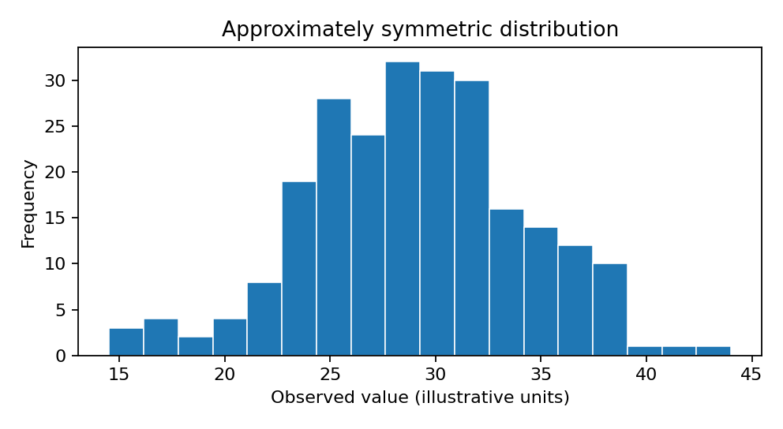
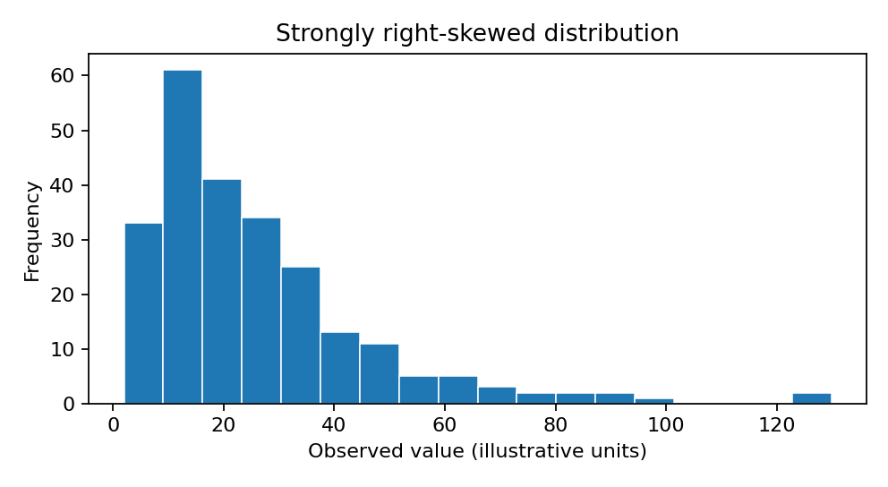

# Choosing and Interpreting Statistical Tests

*A reusable tutorial for undergraduate and postgraduate research, with examples from geography and environmental science.*

## Learning objectives

By the end, you should be able to identify the outcome variable, explanatory variables, number of groups, and sampling design; choose a defensible statistical method; assess assumptions without relying mechanically on a normality test; run common analyses in R or SPSS; and interpret statistical results in context.

## 1. Start with the research question

A statistical test is chosen to answer a *specific question about a population*, not simply because a dataset contains numbers. Before opening software, establish:

1. **Outcome:** What is being measured? Continuous numerical (e.g., temperature), count (e.g., species abundance), binary (flooded/not flooded), nominal (land-use type), or ordinal (1–5 rating)?
2. **Comparison or predictor:** Which groups, time points, or variables are of interest?
3. **Design:** Are observations independent, paired, repeated, clustered within sites, or spatially correlated?
4. **Target:** Do you want a difference in means, medians, distributions, proportions, rates, or a relationship after adjustment for other variables?
5. **Data quality:** How many independent units are there? Are there missing values, unusual observations, unequal variances, or severe skewness?

### Statistical test selection table

| Research question | Suggested method | Why this method? | Important qualification |
|---|---|---|---|
| Does average air pollution differ between urban and rural locations? | **Welch's independent-samples t-test** | Numerical outcome; two **independent** groups; question concerns **means**. Welch's test does not require equal population variances. | Welch's is a type of independent-samples t-test, not a different research design. Inspect independence, outliers, distribution and sample size. |
| Did river nitrate concentration change at the **same sites** before and after an intervention? | **Paired t-test** | Numerical outcome measured twice on the **same units**; tests whether the **mean within-site change** is zero. | Inspect the distribution of the *differences*, not just each time point. If observations are not genuinely paired, this test is inappropriate. |
| Does average soil moisture differ among three land-use categories? | **One-way ANOVA**, or **Welch ANOVA** | Numerical outcome; three independent groups; tests whether all **population means** are equal. Welch ANOVA allows unequal variances. | An omnibus significant result does not identify which groups differ. Use appropriate post-hoc comparisons. |
| Does an ordinal environmental quality rating differ between two independent areas? | **Mann–Whitney U** | Ordinal outcome; two independent groups; rank-based test can detect differences in relative positions/distributions. | It is not automatically a test of median differences. The interpretation depends on distributional shapes and assumptions. |
| Is flood experience associated with whether residents have flood insurance? | **Pearson chi-square test of independence** | Both variables are categorical; tests whether their frequencies are associated. | Use counts, not percentages as input. Check expected counts and independence; consider Fisher's exact test for sparse 2×2 tables. |
| Does temperature differ across sites after accounting for elevation? | **Linear regression or ANCOVA** | Numerical outcome; regression models temperature as a function of location group and elevation, allowing an **adjusted** group comparison. | ANCOVA is a linear regression with categorical group predictors and continuous covariates. Check functional form and whether group-specific slopes are needed. |
| Do repeated pollution measurements differ across locations and months? | **Mixed-effects model** or another repeated-measures approach | Multiple observations from the same location are correlated; random effects can model clustering, while fixed effects can represent month/location differences. | The exact model depends on whether month is categorical/continuous, the sampling structure, serial correlation and spatial dependence. |

**Important:** These are starting points, not universal rules. A design with multiple predictors, spatial autocorrelation, clustered sampling, non-Gaussian outcomes or missing repeated measurements may require a more specialised model.

## 2. Welch's versus Student's independent-samples t-test

Both compare means from **two independent groups**. The distinction concerns the variance assumption.

| Feature | Student's pooled-variance t-test | Welch's t-test |
|---|---|---|
| Question | Are the two population means different? | Same question |
| Independent observations required? | Yes | Yes |
| Equal population variances assumed? | **Yes** | **No** |
| Degrees of freedom | Usually `n1 + n2 - 2` | Adjusted, often non-integer |
| Suitable when group sizes and variances differ? | Can be misleading | Usually preferable |
| Common R command | `t.test(y ~ group, data=d, var.equal=TRUE)` | `t.test(y ~ group, data=d)` |

**Why prefer Welch's as a general default?** It avoids an unnecessary equal-variance assumption and generally behaves well when the variances actually are equal. It is not a cure for non-independence, extreme outliers or severe distributional problems in very small samples.

Do **not** automatically use Levene's test as a gatekeeper that selects Student's when p > .05 and Welch's when p < .05. A non-significant Levene's test does not establish equal variances. Choosing Welch's in advance is often simpler and more defensible.

### Example

Urban PM2.5: `18, 22, 20, 24, 16`  
Rural PM2.5: `9, 12, 11, 13, 10`

Mean urban = 20; mean rural = 11; difference (urban minus rural) = 9. A Welch test gives approximately `t(5.88) = 5.69, p = .00136` when the difference is expressed as urban minus rural. This is evidence of different population means under the model assumptions. The data are illustrative and the very small group sizes make distributional assessment difficult.

## 3. Parametric versus non-parametric: making the final decision

The practical question is **not** “Is Shapiro–Wilk significant?” It is **“Which procedure answers my research question and gives reliable inference for my sampling design and the data I actually have?”** The following is a decision sequence, not a checklist in which each item votes for parametric or non-parametric.

### First, see how the factors combine to produce a decision

The five factors are **not five independent pass/fail tests**. Start with the target of inference and the sampling design, then use the distribution, sample size and outliers to assess whether the proposed analysis is reliable.

**Example A: moderate skew, reasonable sample size**

A researcher compares average PM2.5 concentration between 60 independently sampled urban sites and 60 independently sampled rural sites. The outcome is continuous, the histograms are moderately right-skewed, and there are no extreme influential observations.

- **Research question:** A difference in population **means** is the target, favouring a mean-based procedure.
- **Independence:** Sites are independently sampled, so an independent-groups analysis is plausible.
- **Distribution:** Moderate skew is not necessarily a serious problem for mean-based inference.
- **Sample size:** Sixty independent observations per group can make the sampling distribution of each mean reasonably well behaved under suitable conditions.
- **Outliers:** No extreme influential observations undermine the mean estimates.
- **Final choice:** **Welch's independent-samples t-test** is generally reasonable. Report the mean difference and its confidence interval. Welch's is itself an independent t-test; unlike the classical Student version, it does not assume equal population variances.

**Example B: severe skew, very small sample**

A researcher compares mean pollution at eight independent urban sites and eight independent rural sites. The observations are extremely right-skewed, with several very high genuine readings.

- **Research question:** If the aim remains to compare **means**, the method must still target means.
- **Independence:** The observations are independent, so the design does not itself prevent a two-group comparison.
- **Distribution and sample size:** Severe skew with only eight observations per group makes normal-theory t inference less trustworthy.
- **Outliers:** Genuine extreme readings can dominate the sample means and standard errors.
- **Final choice:** **Do not automatically switch to Mann–Whitney.** Investigate the readings and consider a justified model for the outcome, a robust mean-based approach, a transformation with clearly explained interpretation, or a sensitivity analysis. If the actual question is instead whether values *tend to be higher* in one group, Mann–Whitney may be appropriate.

**Example C: apparent normality but dependent observations**

A researcher has 100 soil measurements from five fields, with 20 samples per field. The histogram looks approximately normal.

- **Distribution:** Normal-looking observations do not solve dependence.
- **Sample size:** There are 100 measurements but only five fields; 100 is not the number of independent field-level replicates.
- **Independence:** Samples within a field may be correlated.
- **Final choice:** **Neither an ordinary independent t-test nor ordinary Mann–Whitney fixes this.** Consider a model or analysis that accounts for clustering, and be cautious because only five clusters may limit reliable inference.

### A practical decision table: what should I do after each check?

| Check | If the result is reassuring | If the result is concerning | What it actually decides |
|---|---|---|---|
| **Question / estimand** | Mean difference is the goal → consider a mean-based test | Ordinal ranking or distributional tendency is the goal → consider a suitable rank method | **What question the test must answer** |
| **Independence** | Independent groups → ordinary independent-group methods may be used | Paired, clustered, or spatially dependent → use a design-aware method | **Which model/test structure is valid** |
| **Distribution** | Roughly symmetric or moderately skewed → t methods may be adequate | Severe skew or heavy tails → examine reliability and alternatives | **How plausible normal-theory inference is** |
| **Sample size** | Sufficient independent observations can improve robustness to moderate skew | Very small independent sample makes distributional assumptions harder to justify | **How much robustness to expect, not an automatic cutoff** |
| **Outliers** | No influential extremes → means and standard errors may be stable | Extreme genuine observations → investigate robust methods and sensitivity | **Whether results are driven by a few observations** |

**Decision rule:** If the question is about means, the design is handled correctly, and diagnostics suggest sufficiently reliable mean-based inference, use a suitable parametric mean-based method. If mean-based inference is fragile, first look for a robust or appropriately modelled method that **still answers the mean question**. Use a non-parametric rank method when its target matches the research question and its own assumptions are credible. If dependence is the problem, correct the design/model rather than changing test families.

### Step 1 — Decide what you want to compare (this determines the destination)

| What the question asks | Start by considering | Do not automatically substitute |
|---|---|---|
| Difference in population **means** | Welch's t-test (two independent groups), paired t-test, ANOVA, regression | Mann–Whitney, because it does not generally test equality of means |
| Difference in **typical values / medians** | Median-focused inference, quantile regression, or suitable robust approaches | Mann–Whitney as an automatic “test of medians” |
| Whether values tend to **rank higher** in one independent group | Mann–Whitney U | A t-test if the ordinal scale does not support a meaningful mean |
| Difference in **proportions / categorical association** | Chi-square, Fisher's exact, two-proportion tests, logistic regression | Either numerical t-test or Mann–Whitney without a reason |
| **Counts/rates** or highly skewed positive outcomes | Poisson/negative-binomial, Gamma/lognormal, or other suitable models | An arbitrary rank test that ignores the count or exposure structure |

**Why?** Parametric methods model parameters such as means and variances. “Non-parametric” covers several methods with different targets and assumptions. It does *not* mean assumption-free. The inferential target is more important than a normality-test p-value.

### Step 2 — Identify the sampling design (this can rule out both simple options)

| Data structure | Consequence for the choice |
|---|---|
| Independent sites/people, one measurement each | An independent-samples method may be appropriate. Continue to Steps 3–5. |
| Before/after measurements from the **same** sites | Use a paired method: paired t-test for mean changes; Wilcoxon signed-rank for an appropriate rank-based paired question. |
| Multiple measurements from the same park, field, person or monitor | Ordinary independent t-tests **and** ordinary Mann–Whitney generally ignore clustering. Consider mixed-effects models, GEE, cluster-aware inference, or justified aggregation. |
| Nearby sites with spatial correlation | Consider a spatial or correlation-aware model. A rank test does **not** fix spatial dependence. |

**Decision:** If independence is violated, the answer is *not* “choose non-parametric.” Change the **design-aware analysis** first. A paired test still assumes independent pairs; a mixed model requires its own appropriate structure and assumptions.

### Visual examples: what do the distributions look like?

The following are **original, simulated-data histograms** created for this tutorial, not images copied from another source. They illustrate the kinds of shapes to inspect before choosing a method.

**Histogram A: approximately symmetric distribution**



The observations cluster around the centre, with roughly similar tails. If the study design is appropriate and there are no influential outliers, a parametric mean comparison such as Welch’s t-test is often reasonable—even with a modest sample.

**Histogram B: strongly right-skewed distribution**



Most observations are relatively low, with a long tail of larger values. **Do not immediately select Mann–Whitney.** With a large enough independent sample, a mean-based test may still be reasonable; with very small samples, severe skew can make ordinary t inference fragile. If the research question concerns typical values or relative ordering rather than means, a median-focused or rank-based method may fit better.

**Compare the two histograms:** Distribution shape informs how trustworthy a method’s approximation is. It does not, by itself, determine which population quantity you should test.

### Step 3 — Assess distribution **together with** sample size

Look at dot plots or histograms, boxplots, and Q–Q plots. For independent mean comparisons, inspect the group distributions and relevant model residuals; for a paired t-test, inspect the **within-pair differences**. Ask how strongly skewed or heavy-tailed they are and whether there are extreme influential values.

| What you observe | Practical decision for a **numerical mean** comparison |
|---|---|
| Approximately symmetric, no extreme outliers, small or moderate sample | Welch's t-test (independent groups) or paired t-test (paired differences) is often reasonable. |
| Mild/moderate skew, about 30–100 **independent observations per group**, no influential outliers | Welch's t-test is often still reasonable. Sample means may have approximately normal sampling distributions. Check group imbalance and sensitivity. |
| Strong skew or heavy tails, only about 5–10 independent observations per group | Standard t-test inference is fragile. Investigate the data; consider a justified transformation, robust mean-based inference, or an alternative model. Use rank methods **if their hypothesis matches the research question**. |
| Strong skew with a large sample | A mean-based test may still be appropriate, but large n is not a guarantee: inspect influential extremes and the stability of estimates. Consider robust sensitivity analyses. |
| Ordinal ratings, especially with few categories | A rank-based method may be more natural if the research question concerns relative ratings; choose based on the intended estimand, not a Shapiro–Wilk result. |

**These sample sizes are illustrations, not cutoffs.** No value of n automatically makes a t-test valid. The central limit theorem helps explain robustness of means under suitable conditions; it does not remove dependence, severe influential outliers, or model misspecification. In an unbalanced two-group comparison, pay particular attention to the smaller group and unequal spreads.

**What does Shapiro–Wilk contribute?** It can flag evidence against exact normality, but it cannot decide the test alone. Small samples can produce non-significant results despite important departures; large samples can produce significant results for unimportant deviations. Always interpret it alongside plots and design.

### Step 4 — Inspect outliers (they can change the recommendation)

Example: `10, 11, 12, 13, 14, 15` has mean **12.5** and median **12.5**. Replacing 15 with 150 gives mean **35** but median **12.5**.

1. Check whether the extreme value is an entry, unit, or measurement error. Correct only documented errors.
2. If genuine, keep it in the data and ask whether it is part of the population of interest.
3. If the question is about **means**, do not silently replace it with a rank test: investigate robust mean-based methods, a justified transformation/model, or transparent sensitivity analysis.
4. If the question is about **typical values or relative ordering**, a median- or rank-focused method may be more aligned.
5. Never remove a valid outlier solely to obtain normality or a desired p-value.

### Step 5 — Make the final choice and explain it in one sentence

Use this decision pathway:

```text
What is the outcome and inferential target?
  |
  +-- Categorical / counts? --> Use a suitable categorical/count model.
  |
  +-- Numerical: compare MEANS?
  |       |
  |       +-- Paired, clustered or spatially correlated?
  |       |       --> Use a design-aware mean model/test.
  |       |
  |       +-- Independent observations?
  |               |
  |               +-- Reasonable shape / adequate n / no severe influence?
  |               |       --> Usually Welch t-test for two groups;
  |               |           ANOVA/Welch ANOVA for 3+ groups.
  |               |
  |               +-- Severe skew, tiny n, influential extremes?
  |                       --> Investigate, then consider robust mean
  |                           inference, transformation or another model.
  |
  +-- Ordinal / relative ranks / distributional tendency?
          |
          +-- Independent groups --> Mann–Whitney (two),
          |                         Kruskal–Wallis (3+), if appropriate.
          +-- Paired observations --> Wilcoxon signed-rank or sign test,
                                    if appropriate.
```

**Important:** The paired Wilcoxon signed-rank test has assumptions (including symmetry of differences for the usual location interpretation); the sign test is a different, sometimes more suitable option. Mann–Whitney can reflect differences in distributional shape or spread, not necessarily a difference in medians.

### Six realistic decisions, with reasons

| Scenario | Final recommendation | Why |
|---|---|---|
| Two independent groups, numerical outcome, 60 per group, moderate skew, no extreme outliers; target is mean pollution | **Welch's t-test** | Independence and mean target match; moderate skew with these sample sizes often does not prevent useful mean-based inference. |
| Two independent groups, numerical outcome, 8 per group, very heavy right tail and extreme genuine observations; target is mean pollution | **Investigate; consider robust mean inference or suitable transformation/model** | Small n and extreme influence make conventional t inference unstable; Mann–Whitney would answer a different question. |
| Two independent areas, 1–5 ordinal quality ratings; interest is which area tends to score higher | **Mann–Whitney U** | Rank comparison aligns with ordinal outcome and relative-ordering question, assuming independent observations. |
| Same 12 monitoring sites measured before and after; approximately symmetric within-site changes | **Paired t-test** | Pairing must be preserved; the mean within-site difference is the target. |
| Same 12 sites before/after; strongly skewed differences with no credible normal model; question is about typical directional change | **Consider Wilcoxon signed-rank or sign test** | Rank/sign methods can suit the changed target; signed-rank's symmetry assumption needs attention. |
| 80 soil cores from 4 fields; comparing management types | **Cluster-aware/mixed-effects analysis, subject to design** | The effective independent replication may be closer to the number of fields; neither ordinary t-test nor Mann–Whitney repairs pseudoreplication. Four clusters can also make inference difficult. |

### What to say in a dissertation or tutoring session

- **Parametric chosen:** “We used Welch's independent-samples t-test because the outcome was numerical, the groups were independent, and our question concerned mean differences. Although the data showed some skewness, group sizes and diagnostics suggested that mean-based inference was reasonable.”
- **Rank-based chosen:** “We used Mann–Whitney U because the outcome was ordinal and we wanted to assess whether ratings tended to be higher in one independent group. We interpret this as a rank/distributional comparison rather than automatically as a test of medians.”
- **Neither simple test appropriate:** “Measurements were repeated within sampling sites, so an ordinary independent-samples t-test or Mann–Whitney U test would not account for within-site correlation. We used a method that reflects the sampling structure.”

**Bottom line:** Distribution, sample size and outliers tell you whether a *particular mean-based method* is likely to be reliable; independence tells you whether the *design is handled correctly*; the research question tells you *what must be estimated or tested*. These considerations work together—there is no automatic “normal = parametric; non-normal = non-parametric” rule.

## 4. Hypotheses, p-values, confidence intervals and effect sizes

- **Null hypothesis (H0):** The parameter or relationship being tested has its null value, often a mean difference of zero.
- **Alternative hypothesis (H1):** The parameter differs from its null value, or differs in a prespecified direction.
- **p-value:** Assuming H0 and the test's assumptions, the probability of a test statistic at least as extreme as the observed statistic. It is **not** the probability that H0 is true.
- **Significance level:** A threshold such as 0.05 chosen to guide decisions. A p-value just above .05 is not proof of no effect.
- **95% confidence interval:** An interval produced by a procedure that covers the true parameter in 95% of hypothetical repetitions under its assumptions. Its width conveys uncertainty.
- **Effect size:** The magnitude of the difference or association. Raw differences are often easier to interpret than standardised ones; report units where possible.

**Example:** Estimated urban minus rural pollution difference = 9 µg/m³, 95% CI [5.2, 12.8]. The estimate is 9 units, with uncertainty spanning plausible differences of about 5–13 units. This can be statistically significant yet still requires an assessment of environmental or policy relevance.

## 5. Worked analyses: dummy data, R, SPSS and interpretation

All examples below use invented data. The printed results are rounded and should be reproduced in software for any final teaching handout or report.

### 5.1 Two independent means: Welch t-test

**Question:** Does mean PM2.5 differ between urban and rural sites?

**Data:** Urban = `18,22,20,24,16`; Rural = `9,12,11,13,10`.

```r
# Make a categorical group variable; each observation has one group
site_type <- factor(c(rep("Urban", 5), rep("Rural", 5)))
# Enter the measured PM2.5 concentrations
pm25 <- c(18, 22, 20, 24, 16, 9, 12, 11, 13, 10)
# Combine variables into a data frame
pollution <- data.frame(site_type, pm25)
# Inspect the data and number of observations per group
print(pollution)
table(pollution$site_type)
# Calculate means and standard deviations by group
aggregate(pm25 ~ site_type, pollution, mean)
aggregate(pm25 ~ site_type, pollution, sd)
# Inspect observations and spread
stripchart(pm25 ~ site_type, pollution, vertical=TRUE, method="jitter")
# Run Welch's t-test (default: unequal variances allowed)
result <- t.test(pm25 ~ site_type, data=pollution)
# Print the test statistic, p-value, estimates and confidence interval
print(result)
```

**Output (rounded):** Rural mean = 11, urban mean = 20; t ≈ −5.69, df ≈ 5.88, p ≈ .00136 (R reports Rural minus Urban because of factor ordering). Urban minus rural mean difference = +9 µg/m³.

**Interpretation:** The illustrative data provide evidence of a difference in population mean pollution, with higher observed urban concentrations. The small samples make assumptions difficult to verify.

**SPSS:** Enter one row per site, with group codes and PM2.5. `Analyze > Compare Means > Independent-Samples T Test`; choose PM2.5 as the test variable and site type as the grouping variable; define group codes; interpret the **Equal variances not assumed** row (or Welch option, depending on version).

### 5.2 Same sites before/after: paired t-test

**Question:** Did nitrate concentration change at the same six river sites?

| Site | Before | After | After − before |
|---|---:|---:|---:|
| 1 | 12 | 9 | −3 |
| 2 | 15 | 11 | −4 |
| 3 | 13 | 11 | −2 |
| 4 | 16 | 12 | −4 |
| 5 | 14 | 11 | −3 |
| 6 | 18 | 13 | −5 |

```r
# Measurements before the intervention, ordered by site
before <- c(12, 15, 13, 16, 14, 18)
# Measurements after the intervention, in the same site order
after <- c(9, 11, 11, 12, 11, 13)
# Calculate within-site changes
change <- after - before
# Inspect the changes, including potential outliers
print(change)
summary(change)
# Assess approximate normality of the differences visually
qqnorm(change)
qqline(change)
# Test whether the mean within-site change is zero
result <- t.test(after, before, paired=TRUE)
# Print results
print(result)
```

**Output (rounded):** Mean change = −3; t(5) ≈ −8.17; p ≈ .00045; 95% CI for after-minus-before approximately [−3.94, −2.06].

**Interpretation:** The measurements show evidence of a mean decrease. Without a control group or suitable causal design, this does not establish that the intervention caused the decrease.

**SPSS:** One row per site, columns `Before` and `After`; `Analyze > Compare Means > Paired-Samples T Test`; select the variables in the desired subtraction order; inspect mean paired difference, t, df, p and CI.

### 5.3 Three independent means: one-way ANOVA

**Question:** Does mean soil moisture differ among woodland, grassland and agricultural sites?

| Woodland | Grassland | Agriculture |
|---:|---:|---:|
| 28 | 20 | 15 |
| 30 | 22 | 17 |
| 32 | 19 | 14 |
| 29 | 21 | 16 |
| 31 | 23 | 18 |

```r
# Assign five observations to each land-use category
landuse <- factor(rep(c("Woodland", "Grassland", "Agriculture"), each=5))
# Enter moisture observations in the same group order
moisture <- c(28,30,32,29,31, 20,22,19,21,23, 15,17,14,16,18)
# Create the dataset
d <- data.frame(landuse, moisture)
# Inspect means and spread
aggregate(moisture ~ landuse, d, mean)
boxplot(moisture ~ landuse, data=d)
# Fit the equal-variance one-way ANOVA model
fit <- aov(moisture ~ landuse, data=d)
# Print omnibus F-test
summary(fit)
# Inspect residuals visually
qqnorm(residuals(fit))
qqline(residuals(fit))
# Compare group pairs with Tukey's multiplicity adjustment
TukeyHSD(fit)
# If unequal variances are a concern, run Welch ANOVA
oneway.test(moisture ~ landuse, data=d, var.equal=FALSE)
```

**Output (rounded):** Means: woodland 30, grassland 21, agriculture 16. Classical one-way ANOVA: F(2,12) ≈ 100.67, p < .001. Tukey comparisons identify which group pairs differ.

**Interpretation:** There is evidence that at least one population mean differs. The omnibus F-test alone does not identify the pairs; post-hoc tests do that.

**SPSS:** `Analyze > Compare Means > One-Way ANOVA`; numerical outcome in Dependent List; categorical group in Factor. Request descriptives, variance diagnostics and appropriate post-hoc tests. For unequal variances, use Welch ANOVA and Games–Howell comparisons where supported.

### 5.4 Two independent ordinal groups: Mann–Whitney U

**Question:** Do environmental quality ratings differ between two neighbourhoods?

A = `4,5,4,3,5,4`; B = `2,3,2,3,1,2`.

```r
# Enter ordinal ratings from neighbourhood A
A <- c(4,5,4,3,5,4)
# Enter ordinal ratings from neighbourhood B
B <- c(2,3,2,3,1,2)
# Report medians as useful descriptive summaries
median(A)
median(B)
# Compare independent samples using ranks
# Ties are present, so request an asymptotic calculation
result <- wilcox.test(A, B, exact=FALSE, correct=FALSE)
# Print the rank-sum statistic and approximate p-value
print(result)
```

**Output (rounded):** Median A = 4, median B = 2; R's W = 35, p ≈ .0053 under the specified normal approximation with tie adjustment.

**Interpretation:** Ratings tend to be higher in A than B; the rank-based test provides evidence of different relative distributions. Do not claim that Mann–Whitney always tests a difference in medians.

**SPSS:** `Analyze > Nonparametric Tests > Legacy Dialogs > 2 Independent Samples`; choose rating as the test variable, area as grouping variable and Mann–Whitney U as the test.

### 5.5 Association between categorical variables: chi-square

**Question:** Is previous flood experience associated with insurance status?

| Flood experience | Insured | Not insured |
|---|---:|---:|
| Yes | 30 | 10 |
| No | 20 | 40 |

```r
# Create the 2-by-2 table of observed household counts
counts <- matrix(c(30,10,20,40), nrow=2, byrow=TRUE)
# Label rows and columns
rownames(counts) <- c("Flood_yes", "Flood_no")
colnames(counts) <- c("Insured", "Not_insured")
# Show observed counts
print(counts)
# Calculate within-row proportions
prop.table(counts, margin=1)
# Run uncorrected Pearson chi-square test
result <- chisq.test(counts, correct=FALSE)
# Show statistic, degrees of freedom and p-value
print(result)
# Check expected frequencies under independence
print(result$expected)
# Alternative exact test for an appropriate sparse 2-by-2 table
fisher.test(counts)
```

**Output (rounded):** χ²(1, N=100) = 16.67, p < .001. All expected cell counts are at least 20. Among households with flood experience, 75% are insured, versus 33.3% without flood experience.

**Interpretation:** Flood experience and insurance status are associated in the illustrative sample. Association is not proof of causation.

**SPSS:** `Analyze > Descriptive Statistics > Crosstabs`; place the two categorical variables in rows and columns; request Chi-square under Statistics and observed/expected counts and row percentages under Cells. If data are already aggregated, weight cases by frequency first.

### 5.6 Adjusted numerical outcome: linear regression / ANCOVA

**Question:** Does temperature differ between urban and rural sites after accounting for elevation?

```r
# Create a small illustrative dataset with one row per independent site
site <- factor(rep(c("Urban", "Rural"), each=6))
# Enter site elevation in metres
elevation <- c(50,80,120,160,200,240, 60,100,140,180,220,260)
# Enter measured temperatures in degrees Celsius
temp <- c(22.0,21.3,20.8,20.1,19.6,18.9, 20.5,19.8,19.4,18.7,18.1,17.6)
# Assemble the data
d <- data.frame(site, elevation, temp)
# Fit an adjusted group comparison with a common elevation slope
model <- lm(temp ~ site + elevation, data=d)
# Display coefficients, standard errors, t-tests and model fit
summary(model)
# Obtain coefficient confidence intervals
confint(model)
# Inspect model diagnostic plots
plot(model)
# Explore whether elevation slopes differ between groups
interaction_model <- lm(temp ~ site * elevation, data=d)
# Inspect the interaction model; do not choose it solely by p-value
summary(interaction_model)
```

**Interpretation:** The coefficient for site type estimates an urban–rural temperature difference at the same elevation, subject to model coding and assumptions. The elevation coefficient estimates the temperature change associated with one metre of elevation under the common-slope model. Check overlap in elevation ranges, linearity, residual behaviour, independence and possible interactions. With observational data, an adjusted association need not be causal.

**SPSS:** `Analyze > General Linear Model > Univariate`; temperature as Dependent Variable, site type as Fixed Factor, elevation as Covariate. Inspect parameter estimates and diagnostics. Alternatively, `Analyze > Regression > Linear` with appropriately coded categorical predictors.

### 5.7 Repeated measurements: mixed-effects model

**Question:** How does pollution change across months when the same sites are sampled repeatedly?

```r
# Install lme4 once if it is not already installed
# install.packages("lme4")
# Load the package for linear mixed-effects models
library(lme4)
# Create four site identifiers, each measured in three months
site <- factor(rep(c("S1","S2","S3","S4"), each=3))
# Create month labels for repeated observations
month <- factor(rep(c("Jan","Feb","Mar"), times=4))
# Enter illustrative pollution values by site and month
pm25 <- c(18,20,17, 24,25,22, 12,13,11, 16,18,15)
# Combine the variables
d <- data.frame(site, month, pm25)
# Fit month as a fixed effect and site as a random intercept
model <- lmer(pm25 ~ month + (1 | site), data=d, REML=TRUE)
# Display fixed effects and estimated site-level variation
summary(model)
# Inspect residuals and fitted values
plot(model)
# Inspect residual normality visually
qqnorm(resid(model))
qqline(resid(model))
```

**Interpretation:** The month coefficients represent differences from the reference month, after allowing sites to have different baseline pollution levels. A random intercept accounts for correlation among repeated observations within a site. The model above is a teaching example, not a full inferential analysis: formal p-values, uncertainty intervals, serial correlation, spatial effects and model selection require further consideration. With only four sites, the site-level variance is imprecisely estimated.

**SPSS:** `Analyze > Mixed Models > Linear`; define the site identifier as the subject, specify month as a fixed effect and a random site intercept. Where relevant, specify a repeated covariance structure for measurements within site. Exact dialog steps vary by version and study design.

## 6. Interpreting and reporting output

Use this sequence consistently:

1. **Describe the sample:** independent units per group, missing values, group means/SDs or medians/IQRs, proportions as appropriate.
2. **Name the test and why:** outcome type, design, target parameter and assumptions.
3. **State the estimated difference or association:** direction, size and units.
4. **Report uncertainty:** confidence interval when appropriate, test statistic, degrees of freedom and p-value.
5. **Explain practical meaning:** whether the difference is substantively important; avoid causal claims unsupported by design.

**Reporting template for two independent means:**

> Mean [outcome] was [mean ± SD] in [group A] and [mean ± SD] in [group B]. A Welch independent-samples t-test estimated a mean difference of [estimate] [units] (95% CI [lower, upper]), t([df]) = [statistic], p = [value]. This suggests [substantive interpretation], subject to [important limitation].

**Reporting template for a non-significant test:**

> The analysis did not provide sufficient evidence of a difference at the prespecified significance level (estimate [value], 95% CI [lower, upper], p = [value]). This does not establish that the population values are equal; the interval indicates the range of differences compatible with the data and model.

## 7. Frequent mistakes and corrections

| Mistake | Better approach |
|---|---|
| “Shapiro–Wilk p < .05 means I must use Mann–Whitney.” | Inspect shape, outliers, sample size, target estimand and design; consider robustness and alternative models. |
| “Welch's t-test is not an independent t-test.” | Welch's **is** an independent-samples t-test; it relaxes the equal-variance assumption. |
| “A non-significant Levene's test proves equal variances.” | It does not; Welch's is often a reasonable prespecified default. |
| “Mann–Whitney compares medians.” | Not generally; it is rank-based and its median interpretation needs extra assumptions. |
| “p > .05 means the groups are the same.” | It means insufficient evidence against the tested null, not proof of equivalence. |
| “p < .05 means the difference is important.” | Examine effect size, units, confidence interval and context. |
| “All 100 readings are independent because there are 100 rows.” | Check whether readings are nested within sites or repeated over time. |
| “ANOVA shows all three groups differ.” | The omnibus test only indicates at least one mean differs; use suitable pairwise comparisons. |
| “Remove outliers until the test is significant.” | Investigate errors and influence; retain valid observations unless exclusion has a defensible prespecified rationale. |
| “A before–after difference proves the intervention worked.” | Causal attribution needs a suitable research design and control of alternative explanations. |

## 8. Tutor's short diagnostic checklist

- [ ] Can the researcher express the question as a comparison or relationship?
- [ ] Is the outcome continuous, ordinal, nominal, binary or count?
- [ ] Are groups independent, paired, repeated or clustered?
- [ ] Is the goal a mean, median, distribution, proportion, rate or adjusted effect?
- [ ] Are the numbers of *independent* observations adequate?
- [ ] Have distributions, outliers, unequal variances and missingness been inspected?
- [ ] Does the selected method answer the actual question?
- [ ] Can the researcher explain the effect estimate, interval and p-value in ordinary language?
- [ ] Have assumptions, limitations and practical relevance been reported?

## 9. Further reading

- R documentation: `?t.test`, `?aov`, `?oneway.test`, `?wilcox.test`, `?chisq.test`, `?lm` and `?lmer` (after loading `lme4`).
- UCLA Statistical Methods and Data Analytics: https://stats.oarc.ucla.edu/
- Penn State online statistics courses: https://online.stat.psu.edu/statprogram/
- NIST/SEMATECH e-Handbook of Statistical Methods: https://www.itl.nist.gov/div898/handbook/

*Version 1.1. Expanded integrated decision examples. Educational examples use invented data. The methods are not a substitute for study-specific statistical advice.*
