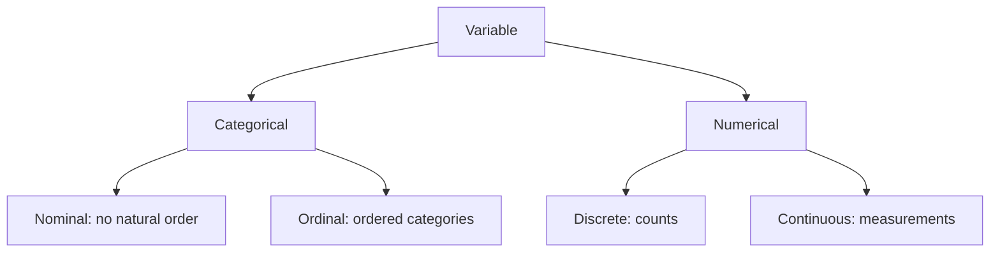
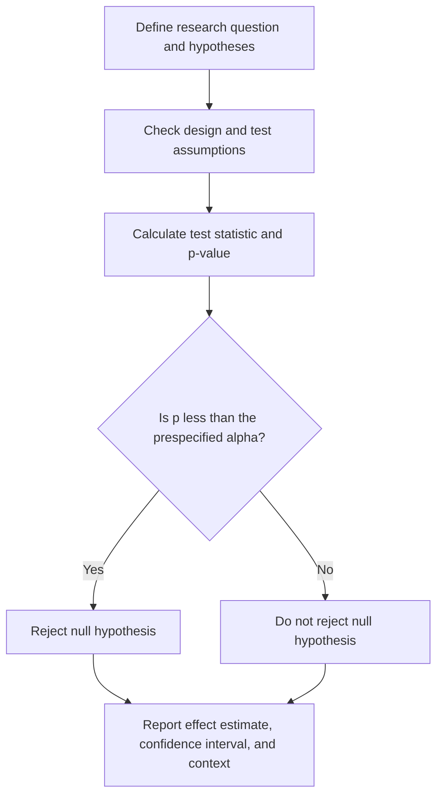
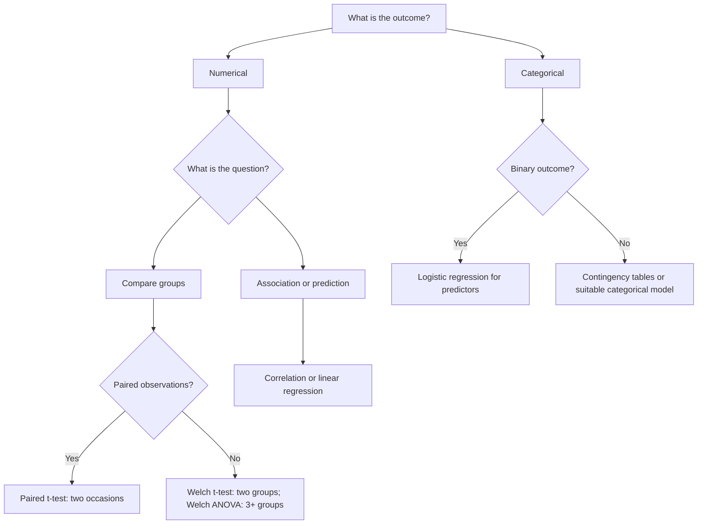

# Introductory Statistics: A Practical Tutorial with R and SPSS

*A reusable, self-contained learning resource for introductory statistics, health research, and applied data analysis.*

**Level:** Beginner to intermediate  
**Prerequisites:** Basic arithmetic and percentages  
**Software:** R (base R) and IBM SPSS Statistics  
**Data:** All examples are fictional and intended for teaching.

## Learning objectives

By the end of this tutorial, readers should be able to distinguish variable types, select useful summaries and plots, recognise common distribution shapes, calculate binomial and Normal probabilities, interpret risk and relative risk, understand confidence intervals and hypothesis tests, and select introductory statistical methods based on research design.

## Contents

1. Variables and data types
2. Descriptive statistics and visualisation
3. Distributions: shape, skewness, and modality
4. The binomial distribution
5. The Normal distribution
6. Risk, risk difference, and relative risk
7. Sampling, standard errors, and confidence intervals
8. Hypothesis testing and p-values
9. Choosing a statistical method
10. Worked analysis: two independent group means
11. Common misconceptions
12. Practice questions and answers
13. Reproducible R script and further reading

---

# 1. Variables and data types

A **variable** is a characteristic that can differ across observations. Identifying its type is the first step in choosing an appropriate summary, graph, or analysis.



| Type | Meaning | Examples | Common summaries |
|---|---|---|---|
| Nominal categorical | Categories without meaningful order | Blood group, smoking status | Counts, percentages |
| Ordinal categorical | Categories with meaningful order | Mild/moderate/severe, satisfaction rating | Counts, percentages, median category when appropriate |
| Discrete numerical | Countable numerical outcomes | Number of hospital visits, children | Counts, mean, median |
| Continuous numerical | Measurements on a scale | Height, blood pressure, glucose | Mean/SD or median/IQR |

**Important distinction:** A variable recorded as numbers is not necessarily numerical in a statistical sense. For example, coding smoking status as 0 = no and 1 = yes does not make it a continuous measurement.

## Example: a fictional health survey

| Participant | Smoking status | Visits last year | Systolic BP (mmHg) | Self-rated health |
|---|---|---:|---:|---|
| A | No | 0 | 112 | Good |
| B | Yes | 3 | 146 | Fair |
| C | No | 1 | 124 | Good |
| D | Yes | 2 | 138 | Poor |
| E | No | 0 | 119 | Excellent |

Here, smoking status is nominal, visits are discrete, systolic BP is continuous, and self-rated health is ordinal.

# 2. Descriptive statistics and visualisation

**Descriptive statistics** summarise the data actually observed. They do not, by themselves, establish conclusions about a larger population.

## 2.1 Centre: mean, median, and mode

Consider hospital stays (days):

`1, 1, 2, 2, 2, 3, 3, 4, 5, 17`

- **Mean:** Sum divided by sample size = 40/10 = **4 days**.
- **Median:** Middle of sorted data = (2 + 3)/2 = **2.5 days**.
- **Mode:** Most frequent value = **2 days**.

The mean is pulled upwards by the unusually long 17-day stay. The median better represents the middle of this skewed sample.

## 2.2 Spread: range, IQR, and standard deviation

- **Range:** Maximum minus minimum = 17 − 1 = **16 days**.
- **Interquartile range (IQR):** Third quartile minus first quartile; describes the spread of the middle 50%.
- **Sample standard deviation (SD):** Describes the typical scale of deviations from the sample mean, using squared deviations.

\[
s=\sqrt{\frac{\sum_{i=1}^n(x_i-\bar{x})^2}{n-1}}
\]

The sample SD for these stays is approximately **4.76 days**. Quartile conventions can differ slightly between software packages, especially in small samples.

### Illustration: effect of an extreme observation

```text
Most stays:       1 1 2 2 2 3 3 4 5                         17
                  |------- clustered values ------|        |
Median: 2.5 days                Mean: 4 days
```

## 2.3 Choosing a graph

| Question | Variable(s) | Graph |
|---|---|---|
| How common is each smoking category? | One categorical | Bar chart |
| What is the distribution of BP? | One continuous | Histogram |
| Are hospital stays skewed? | One numerical | Histogram or boxplot |
| Does BP differ across groups? | Numerical + categorical | Side-by-side boxplots |
| Is age related to BP? | Two numerical | Scatterplot |
| Is smoking associated with infection? | Two categorical | Grouped/stacked bars or mosaic plot |

**Histogram versus bar chart:** A histogram divides a numerical scale into adjacent intervals; a bar chart represents separate categories. The apparent shape of a histogram depends partly on the bin width.

## 2.4 R demonstration

```r
# Create a vector of fictional hospital stays
stays <- c(1, 1, 2, 2, 2, 3, 3, 4, 5, 17)

# Calculate the arithmetic mean
mean(stays)

# Find the median
median(stays)

# Calculate the sample standard deviation
sd(stays)

# Calculate the interquartile range
IQR(stays)

# Display minimum, quartiles, median, mean, and maximum
summary(stays)

# Draw a histogram of the numerical observations
hist(stays, breaks = seq(0, 18, by = 2),
     main = "Hospital length of stay", xlab = "Days")

# Draw a boxplot to inspect the centre, spread, and possible outliers
boxplot(stays, horizontal = TRUE, xlab = "Days")
```

**Selected output:** mean = 4; median = 2.5; sample SD ≈ 4.76. Interpret the mismatch between mean and median alongside the histogram rather than using a single statistic to declare a distribution skewed.

**SPSS:** Enter one row per patient and one numeric column `stays`. Select **Analyze > Descriptive Statistics > Explore**; put `stays` in **Dependent List**. Under **Plots**, request a histogram and boxplot. The Descriptives table reports mean, median, SD, and IQR.

---

# 3. Distribution shapes, skewness, and modality

A **distribution** describes how values or probabilities are spread across possible outcomes.

- **Symmetric:** Left and right sides have roughly matching shapes.
- **Right-skewed:** Longer tail to the right, as with some hospital-stay or income data.
- **Left-skewed:** Longer tail to the left, as with scores on an easy exam.
- **Unimodal:** One main peak.
- **Bimodal:** Two main peaks; this may indicate a mixture of populations.

```text
Symmetric            Right-skewed         Left-skewed
     /\                 /\                      /\
   /    \              /  \___            ___/  \
__/      \__          /       \____  ____/       \ 
```

**A unimodal distribution is not necessarily Normal.** Normality additionally requires a particular symmetric bell shape. Continuous variables are not automatically Normal.

---

# 4. The binomial distribution

A binomial model counts the number of **successes** in a fixed number of trials. A success is simply the event of interest; it need not be desirable.

Conditions: (1) fixed number of trials, (2) two possible outcomes per trial, (3) independent trials, and (4) constant probability of success.

If \(X\sim\mathrm{Binomial}(n,p)\), then

\[
P(X=k)=\binom{n}{k}p^k(1-p)^{n-k},\qquad
E[X]=np,\qquad SD(X)=\sqrt{np(1-p)}.
\]

## Worked example: vaccination counts

Suppose 10 independently sampled people each have a 70% probability of vaccination. What is the probability that exactly seven are vaccinated?

\[
P(X=7)=\binom{10}{7}(0.7)^7(0.3)^3
=\boxed{0.2668279}.
\]

Thus the probability is approximately **26.7%**. The expected number vaccinated is \(10(0.7)=7\), but an expected count is not a guarantee.

```r
# Specify the number of independent trials
n <- 10

# Specify the probability of success on each trial
p <- 0.70

# Calculate the probability of exactly seven successes
dbinom(7, size = n, prob = p)

# Calculate the probability of at most seven successes
pbinom(7, size = n, prob = p)

# Calculate the probability of at least seven successes
1 - pbinom(6, size = n, prob = p)

# List all possible numbers of successes
x <- 0:n

# Calculate their probability masses
probabilities <- dbinom(x, size = n, prob = p)

# Draw a bar chart of the probability mass function
barplot(probabilities, names.arg = x,
        xlab = "Number vaccinated", ylab = "Probability")
```

**Selected R output:** `dbinom(7, 10, 0.7)` = `0.2668279`; `pbinom(7, 10, 0.7)` ≈ `0.3504`; `1 - pbinom(6, 10, 0.7)` ≈ `0.6496`.

**SPSS:** With a dataset open, choose **Transform > Compute Variable**, set Target Variable to `prob_exact7`, and enter Numeric Expression `PDF.BINOM(7,10,0.7)`. This evaluates the probability for each active case. For cumulative probabilities, use the appropriate binomial CDF function.

**When not to use it:** If each trial has a different success probability, if observations are strongly dependent, or if there are more than two mutually exclusive outcome categories, the ordinary binomial assumptions do not hold.

---

# 5. The Normal distribution

A Normal distribution is a continuous, symmetric, bell-shaped probability model described by a mean \(\mu\) and standard deviation \(\sigma\).

\[
X\sim N(\mu,\sigma^2),\qquad Z=\frac{X-\mu}{\sigma}.
\]

For an exactly Normal distribution, approximately 68%, 95%, and 99.7% of values lie within 1, 2, and 3 standard deviations of the mean, respectively.

```text
                      Mean
                       |
                  .----|----.
               .-'     |     '-.
            .-'        |        '-.
_________.-'___________|___________'-._________
         -2 SD       -1 SD  +1 SD  +2 SD
         <--------- about 95% --------->
```

*The diagram is schematic, not to scale.*

## Worked example: standardising a measurement

Suppose a reference population has a Normally distributed measurement with mean 120 and SD 15. What is the z-score of 150?

\[
Z=(150-120)/15=2.
\]

The measurement is **two standard deviations above the mean**. In this model, the probability of a value at least 150 is approximately 2.28%.

```r
# Specify the population mean
mu <- 120

# Specify the population standard deviation
sigma <- 15

# Specify the observed value
value <- 150

# Calculate the standardised z-score
z <- (value - mu) / sigma

# Calculate the probability of a value at least 150
pnorm(value, mean = mu, sd = sigma, lower.tail = FALSE)

# Find the 97.5th percentile of this Normal distribution
qnorm(0.975, mean = mu, sd = sigma)
```

**Selected output:** `z = 2`; upper-tail probability ≈ `0.02275`; 97.5th percentile ≈ `149.40`.

**SPSS:** Use **Transform > Compute Variable** with `(measurement - 120)/15` to calculate a z-score based on the specified reference values. `CDF.NORMAL(150,120,15)` evaluates the probability below 150; subtract from 1 for the upper-tail probability.

**Important:** A Normal model may be a useful approximation, but it should not be assumed without considering the measurement, population, and purpose of analysis.

---

# 6. Risk, risk difference, and relative risk

**Risk** is the proportion of people initially at risk who experience an event during a specified follow-up period.

\[
Risk=\frac{\text{Number who experience the event}}{\text{Number initially at risk}}.
\]

## Worked example: exposure and infection

Consider a fictional cohort observed for one month:

| Group | Infected | Not infected | Total |
|---|---:|---:|---:|
| Exposed | 30 | 70 | 100 |
| Unexposed | 10 | 90 | 100 |

Risk in exposed = 30/100 = **0.30**; risk in unexposed = 10/100 = **0.10**.

**Risk difference (RD):**

\[
RD=0.30-0.10=\boxed{0.20}
\]

This means **20 additional infections per 100 people**, in absolute terms, in the exposed group over the specified month.

**Relative risk (RR):**

\[
RR=\frac{0.30}{0.10}=\boxed{3.00}
\]

The exposed group had **three times the risk** of infection during the follow-up period.

| RR | Meaning |
|---|---|
| 1 | Equal risk in both groups |
| Above 1 | Higher risk in the numerator group |
| Below 1 | Lower risk in the numerator group |
| 0.6 | 40% lower relative risk, not 40 percentage points lower |

### Approximate confidence interval for RR

With cells \(a=30,b=70,c=10,d=90\):

\[
SE[\log(RR)]=\sqrt{\frac1a-\frac1{a+b}+\frac1c-\frac1{c+d}}
\]

\[
95\%\ CI=\exp\left[\log(RR)\pm1.96SE[\log(RR)]\right]
\]

This yields approximately **1.54 to 5.85**. The interval excludes the null value 1, indicating evidence of an association under the assumed sampling model. This does **not** prove causation.

```r
# Record exposed participants who became infected
a <- 30

# Record exposed participants who did not become infected
b <- 70

# Record unexposed participants who became infected
c <- 10

# Record unexposed participants who did not become infected
d <- 90

# Calculate the two observed risks
risk_exposed <- a / (a + b)
risk_unexposed <- c / (c + d)

# Calculate absolute risk difference
RD <- risk_exposed - risk_unexposed

# Calculate relative risk
RR <- risk_exposed / risk_unexposed

# Estimate the standard error on the log scale
SE_logRR <- sqrt(1/a - 1/(a+b) + 1/c - 1/(c+d))

# Calculate the lower 95% confidence limit
lower <- exp(log(RR) - 1.96 * SE_logRR)

# Calculate the upper 95% confidence limit
upper <- exp(log(RR) + 1.96 * SE_logRR)

# Display the point estimates and interval
data.frame(risk_exposed, risk_unexposed, RD, RR, lower, upper)
```

**Expected output (rounded):** risks `0.30` and `0.10`; RD `0.20`; RR `3.00`; 95% CI `1.54–5.85`.

### SPSS: 2 × 2 table

Create four records:

| exposure | infection | count |
|---:|---:|---:|
| 1 | 1 | 30 |
| 1 | 0 | 70 |
| 0 | 1 | 10 |
| 0 | 0 | 90 |

Choose **Data > Weight Cases**, select `count`; then **Analyze > Descriptive Statistics > Crosstabs**. Put `exposure` in Rows and `infection` in Columns; under **Statistics** request **Risk**, and under **Cells** request observed counts and row percentages. **Check the category order and event definition** before reading the relative risk; some reported ratios may be for the opposite event or reversed comparison. Switch weighting off when finished.

**Study design warning:** RR is naturally estimated from cohort studies or trials with observed denominators. In ordinary case-control sampling, risks generally cannot be recovered directly from the sampled case/control totals; odds ratios are commonly used instead.

---

# 7. Sampling, standard errors, and confidence intervals

A **population parameter** is a quantity of interest for a whole population (such as \(\mu\)); a **sample statistic** estimates it (such as \(\bar{x}\)). Different random samples produce different estimates.

**Standard deviation (SD)** describes spread among individual observations. **Standard error (SE)** describes sampling variability of an estimate. For a mean from independent observations:

\[
SE(\bar{x})=\frac{s}{\sqrt{n}}.
\]

Larger samples typically produce smaller SEs, assuming comparable variability and appropriate sampling.

## Worked example: 95% CI for a mean

Suppose \(n=100\), sample mean \(\bar{x}=125\), and sample SD \(s=15\).

\[
SE=15/\sqrt{100}=1.5.
\]

Using a Normal approximation:

\[
125\pm1.96(1.5)=[122.06,127.94].
\]

When the population SD is unknown, a t-based interval is generally preferable under the relevant assumptions:

\[
\bar{x}\pm t_{0.975,n-1}\frac{s}{\sqrt{n}}
\]

This gives approximately **[122.02, 127.98]**.

### Interpretation

The sample mean is 125, and the 95% CI describes a range of population means consistent with the data and the statistical model. Across many repetitions of this sampling-and-interval procedure, approximately 95% of constructed intervals would contain the fixed true mean. It is **not** a 95% probability statement about the already-calculated interval.

```r
# Specify the observed sample mean
xbar <- 125

# Specify the observed sample standard deviation
s <- 15

# Specify the sample size
n <- 100

# Calculate the standard error
SE <- s / sqrt(n)

# Obtain the 97.5th percentile of the t distribution
critical <- qt(0.975, df = n - 1)

# Calculate the two-sided 95% confidence interval
CI <- xbar + c(-1, 1) * critical * SE

# Display the confidence limits
CI
```

**Expected output:** approximately `122.0237 127.9763`.

**SPSS:** With the 100 original measurements available, use **Analyze > Descriptive Statistics > Explore**; select the measurement as the dependent variable and request **95% confidence interval for the mean**. Summary statistics alone cannot be entered into Explore as though they were 100 raw observations.

### Confidence interval for a proportion

If 70 of 100 people are vaccinated, the sample proportion is 0.70. For binomial proportions, the **Wilson score interval** is often preferable to the simple Wald interval, particularly with small samples or proportions near 0 or 1.

```r
# Calculate an approximate Wilson interval for 70 successes in 100 trials
prop.test(x = 70, n = 100, correct = FALSE)
```

This returns a confidence interval for the population proportion (approximately **0.604–0.781**). The exact method and confidence level should always be reported.

---

# 8. Hypothesis testing and p-values

A hypothesis test evaluates whether data are compatible with a specified **null hypothesis** under a statistical model.

- \(H_0\): Null hypothesis, often no difference or no association.
- \(H_1\): Alternative hypothesis, often a difference or association.
- **p-value:** Assuming \(H_0\) and the model are true, the probability of obtaining a test statistic at least as extreme as the observed statistic.
- **Significance level** \(\alpha\): A pre-specified decision threshold, often 0.05.



**Do not say:** “p = 0.03 means there is a 3% probability the null hypothesis is true.” That is incorrect.

**Do not say:** “p > 0.05 proves there is no difference.” It may simply mean the study did not provide enough evidence to detect a difference.

Statistical significance does not imply clinical, practical, or causal importance.

---

# 9. Choosing a statistical method

Always start with the **research question, outcome type, and design**, not just a normality test.

| Research question | Common starting method | Key considerations |
|---|---|---|
| Compare means in two independent groups | Welch's independent t-test | Independence, outliers, reasonable sampling distribution |
| Compare means before and after in the same people | Paired t-test | Analyse paired differences |
| Compare means across 3+ independent groups | Welch's ANOVA | Independence, follow-up comparisons |
| Examine association between two categorical variables | Chi-square test | Expected counts; Fisher's exact for sparse tables |
| Examine linear association between two numerical variables | Pearson correlation | Linear form, outliers, independent pairs |
| Examine monotonic association | Spearman rank correlation | Ranks, ties, monotonicity |
| Compare ordinal/ranked outcomes across two independent groups | Mann–Whitney U | Does not universally test medians |
| Predict a numerical outcome from predictors | Linear regression | Model form, residual assumptions, independence |
| Predict a binary outcome | Logistic regression | Outcome coding, independence, model specification |



These are simplified starting points. Repeated measures, clustering, unequal follow-up, confounding, missing data, and nonlinearity may require other methods.

---

# 10. Worked example: comparing two independent means

## Research question

Do two independent groups differ in mean systolic blood pressure?

### Fictional summary data

| Statistic | Intervention group | Comparison group |
|---|---:|---:|
| Sample size | 40 | 40 |
| Mean (mmHg) | 120 | 128 |
| Sample SD (mmHg) | 12 | 14 |

We use **Welch's two-sided t-test**. The test does not require equal population variances.

\[
H_0:\mu_1-\mu_2=0,\qquad H_1:\mu_1-\mu_2\ne0.
\]

Difference in sample means:

\[
\bar{x}_1-\bar{x}_2=120-128=-8.
\]

Standard error:

\[
SE=\sqrt{\frac{12^2}{40}+\frac{14^2}{40}}\approx2.915.
\]

Test statistic:

\[
t=\frac{-8}{2.915}\approx-2.744.
\]

Welch degrees of freedom are approximately 76.2.

## R implementation from summary statistics

```r
# Enter group sample sizes
n1 <- 40
n2 <- 40

# Enter group means
mean1 <- 120
mean2 <- 128

# Enter group sample standard deviations
sd1 <- 12
sd2 <- 14

# Calculate the estimated mean difference
difference <- mean1 - mean2

# Calculate its standard error under independent sampling
SE <- sqrt(sd1^2 / n1 + sd2^2 / n2)

# Calculate the Welch t-statistic
t_value <- difference / SE

# Calculate the Welch-Satterthwaite degrees of freedom
df <- (sd1^2/n1 + sd2^2/n2)^2 /
      ((sd1^2/n1)^2/(n1-1) + (sd2^2/n2)^2/(n2-1))

# Calculate the two-sided p-value
p_value <- 2 * pt(-abs(t_value), df = df)

# Find the critical t-value for a 95% confidence interval
critical <- qt(0.975, df = df)

# Calculate the confidence limits for the mean difference
CI <- difference + c(-1, 1) * critical * SE

# Display a compact results table
round(data.frame(difference, SE, t_value, df, p_value,
                 CI_lower = CI[1], CI_upper = CI[2]), 4)
```

### Expected output (approximately)

```text
  difference     SE t_value      df p_value CI_lower CI_upper
1         -8 2.9155 -2.7439 76.2126  0.0076   -13.81    -2.19
```

**Interpretation:** The intervention group's mean was estimated to be 8 mmHg lower than the comparison group's (mean difference −8 mmHg, 95% CI approximately −13.81 to −2.19, p ≈ 0.008). Under the model, this provides evidence of a difference in population means. Whether the difference is clinically meaningful, and whether it can be attributed to an intervention, depends on study design and subject-matter context.

## R with individual-level observations

If actual patient-level data are available in a data frame `dat`, with columns `bp` and `group`:

```r
# Convert group codes to a categorical variable
 dat$group <- factor(dat$group)

# Summarise each group before testing
 aggregate(bp ~ group, data = dat, FUN = mean)

# Draw a boxplot to inspect distributions by group
 boxplot(bp ~ group, data = dat, xlab = "Group", ylab = "Blood pressure")

# Run Welch's independent-samples t-test (default in R)
 t.test(bp ~ group, data = dat, var.equal = FALSE)
```

This code requires actual observations; it cannot reproduce the exact fictional summary-statistics example unless a dataset with matching summaries is supplied.

## SPSS implementation

With one row per participant and columns `bp` and `group`:

1. Select **Analyze > Compare Means > Independent-Samples T Test**.
2. Move `bp` to **Test Variable(s)**.
3. Move `group` to **Grouping Variable** and define the two codes.
4. Run the test.
5. Read the row for **equal variances not assumed** (Welch), noting the t statistic, degrees of freedom, p-value, mean difference, and confidence interval.
6. Confirm the group order so that the sign of the reported mean difference is interpreted correctly.

---

# 11. Common misconceptions

| Misconception | More accurate understanding |
|---|---|
| Continuous data are always Normal | Continuous data can be symmetric, skewed, multimodal, or otherwise distributed |
| Unimodal means Normal | One peak alone does not establish Normality |
| Mean and median always match | They may differ substantially with skewness or outliers |
| SD and SE mean the same thing | SD describes observations; SE describes uncertainty in an estimate |
| RR = 3 means 3 percentage points more risk | RR = 3 means three times the risk; the absolute difference must be calculated separately |
| A 95% CI means a 95% probability the fixed parameter is inside this observed interval | The 95% refers to long-run coverage of the interval-building procedure |
| p < 0.05 proves the alternative hypothesis | It indicates evidence against the null under assumptions, not proof |
| p > 0.05 proves equality | It means insufficient evidence to reject the null, not demonstrated equivalence |
| A significant association proves causation | Confounding, selection, bias, and study design must be considered |
| The Mann–Whitney test always compares medians | Its interpretation depends on distributional assumptions and the estimand |

---

# 12. Practice questions

Try these before reading the answers.

**Q1.** Classify the variables: blood group, disease severity (mild/moderate/severe), number of clinic visits, height.

**Q2.** For `2, 3, 3, 4, 18`, calculate the mean and median. Which better represents a typical value?

**Q3.** A binomial experiment has 5 independent trials and success probability 0.4. What is the probability of exactly 2 successes?

**Q4.** A measurement is 140 in a Normal reference population with mean 110 and SD 15. What is its z-score?

**Q5.** Infection occurs in 12/60 exposed participants and 6/60 unexposed participants. Calculate both risks, the risk difference, and RR.

**Q6.** A 95% CI for a mean difference is [−6, −1]. Does it include the null value for a mean difference? What does that imply for the corresponding two-sided 5% test under matching assumptions?

**Q7.** Which test is a sensible starting point for comparing mean blood pressure before and after treatment in the same 25 people?

## Answers

**A1.** Blood group: nominal; disease severity: ordinal; clinic visits: discrete numerical; height: continuous numerical.

**A2.** Mean = 30/5 = **6**; median = **3**. The median is less affected by the extreme value 18.

**A3.** \(\binom52(0.4)^2(0.6)^3=\boxed{0.3456}\), or 34.56%.

**A4.** \(z=(140-110)/15=\boxed{2}\).

**A5.** Exposed risk = 0.20; unexposed risk = 0.10; RD = 0.10 (10 percentage points); RR = 2.

**A6.** The interval excludes zero; for a matching two-sided test, the null of zero mean difference would be rejected at the 5% level. The estimate is negative, but its importance depends on the context.

**A7.** A paired t-test, assuming paired differences are appropriate for a t-based analysis. Examine the differences and relevant assumptions.

---

# 13. Further reading and teaching notes

Useful public resources:

- NIST/SEMATECH Engineering Statistics Handbook: https://www.itl.nist.gov/div898/handbook/
- NIST explanation of confidence intervals: https://itl.nist.gov/div898/handbook/prc/section1/prc14.htm
- UK public health guidance on risk ratios: https://fingertips.phe.org.uk/static-reports/public-health-technical-guidance/Basic_statistics/Odds_ratios_relative_risk.html
- UK public health guidance on proportions: https://fingertips.phe.org.uk/static-reports/public-health-technical-guidance/Basic_statistics/Proportions.html
- CDC Field Epidemiology Manual, analysing and interpreting data: https://www.cdc.gov/field-epi-manual/php/chapters/analyze-interpret-data.html

## Suggested teaching sequence

1. Begin with variables and visualisations; ask learners to classify real examples.
2. Use the hospital-stay dataset to distinguish mean, median, SD, and skewness.
3. Use vaccination counts to introduce binomial probabilities.
4. Introduce the Normal model and z-scores as a different kind of distribution.
5. Compare exposed and unexposed groups using absolute and relative risk.
6. Explain how sampling creates uncertainty, leading to standard errors and confidence intervals.
7. Introduce hypothesis testing and report effect sizes alongside p-values.
8. Choose methods from the research question and design; use software only after the estimand and assumptions are clear.

**Reusability note:** Examples are invented. Software menu labels can differ between SPSS versions. When teaching from this document, confirm assumptions and check outputs against the version in use.
