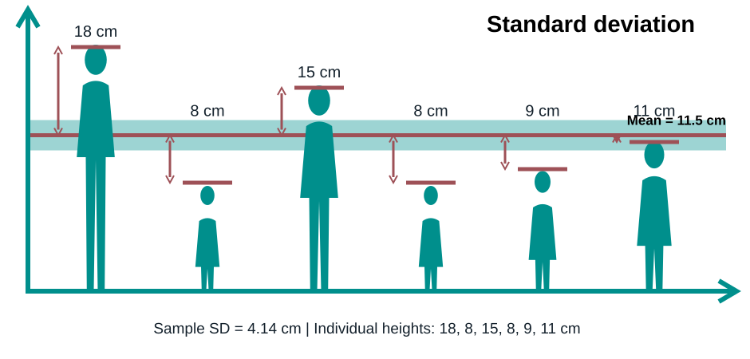

# Stat Key Concepts: Estimation, Variability and Confidence Intervals

*A reusable introductory statistics tutorial with examples, worked calculations, interpretation, and R/SPSS guidance.*
*Also check [the infographic here](https://github.com/erikaris/301/blob/main/Estimation%20and%20Confidence%20Intervals%20Infographic.png)*

## Learning objectives

By the end of this tutorial, readers should be able to distinguish populations from samples and parameters from statistics; recognise common sampling methods; distinguish sampling error from bias; explain variance, standard deviation and standard error; and calculate and interpret confidence intervals for means, proportions and differences between groups.

## 1. Populations, samples, parameters and statistics

A **population** is the full group about which we want to draw conclusions. A **sample** is the subset from which observations are collected.

**Example:** A university has 20,000 students. We randomly select 200 to estimate average height. The population is the 20,000 students; the sample is the 200 measured students.

A **population parameter** is a numerical characteristic of the population, usually unknown. A **sample statistic** is a number calculated from the sample and used to estimate a parameter.

| Characteristic | Population parameter | Sample statistic |
|---|---|---|
| Mean | $\mu$ | $\bar{x}$ |
| Standard deviation | $\sigma$ | $s$ |
| Proportion | $p$ | $\hat p$ |
| Number of observations | $N$ | $n$ |

**Example:** If the sample mean height is 169 cm, $\bar x=169$ cm is a **point estimate** of the unknown population mean $\mu$. A different random sample might yield 168 or 170 cm.

## 2. Sampling methods

**Probability sampling** uses a random selection mechanism with known selection probabilities.

| Method | How it works | Example |
|---|---|---|
| Simple random | Select individuals at random from a sampling frame | Randomly choose 100 student IDs |
| Systematic | After a random start, select every $k$th entry | Start at entry 4 and select every 10th name |
| Stratified | Divide into strata, randomly sample within each | Randomly sample students from each year of study |
| Cluster | Randomly select groups, then survey all or some members | Select 10 schools and survey their pupils |
| Multistage | Random selection at successive levels | Select districts, then households, then adults |

**Non-probability sampling** does not provide known selection probabilities.

| Method | Example | Potential limitation |
|---|---|---|
| Convenience | Ask people entering a library | Library visitors may not represent all students |
| Purposive | Recruit experienced teachers for interviews | Designed for a particular group, not population prevalence |
| Snowball | Participants refer other participants | People with similar networks may be overrepresented |
| Quota | Recruit a fixed number from each age group without random selection | Quotas alone do not ensure representativeness |

### Sampling error versus sampling bias

**Sampling error** is random variation in a statistic because only a subset of the population is observed.

**Example:** The true population mean examination score is 70. Three independent random samples give means of 68, 73 and 69. Their sampling errors are −2, +3 and −1 marks respectively. Usually the true population value is unknown, so the actual sampling error cannot be calculated.

**Sampling bias** is systematic distortion arising from how participants are selected or respond.

**Example:** To estimate average weekly study time, a researcher surveys only people in the university library. Those students may study more than average, so the estimate may be biased upward. Increasing the number surveyed in the library does not automatically fix this.

**Non-response bias example:** A survey of household income may overestimate average income if lower-income households are less likely to respond and this difference is not addressed.

**Distinction:** Standard errors and confidence intervals describe sampling uncertainty under assumptions; they do not automatically correct selection or non-response bias.

## 3. Variability, variance and standard deviation

### Variability

Variability means how different the observations are. Consider two sets of test scores:

- Group A: 48, 49, 50, 51, 52 (mean 50).
- Group B: 20, 35, 50, 65, 80 (mean 50).

Both have the same mean, but Group B is more spread out. A mean alone cannot describe that difference.

### Variance

**Variance** measures the average *squared* deviation of values from their mean. It captures how dispersed the values are and gives extra weight to observations far from the mean. Squaring also prevents positive and negative deviations from cancelling out.

Population variance: $\displaystyle \sigma^2=\frac{\sum_{i=1}^{N}(x_i-\mu)^2}{N}$.

Sample variance: $\displaystyle s^2=\frac{\sum_{i=1}^{n}(x_i-\bar x)^2}{n-1}$.

**Worked example:** Observations 4, 6, 8 have mean 6. Deviations are −2, 0, +2; squared deviations are 4, 0, 4. Population variance (if these are the whole population) is $8/3=2.67$ squared units. Sample variance (if these are a sample) is $8/(3-1)=4$ squared units. The $n-1$ divisor adjusts for estimating the mean from the same sample and yields an unbiased sample variance estimator under independent identical sampling with finite variance.

**Why is variance useful beyond being SD squared?** It quantifies dispersion in a way that makes large departures count more heavily. Variances can be added for independent random variables, and variance decomposition underlies regression, ANOVA and many statistical models. Its disadvantage is that the units are squared: height variance is in cm², not cm.

### Standard deviation

**Standard deviation (SD)** is the square root of variance, returning dispersion to the original measurement units.

Sample SD: $\displaystyle s=\sqrt{\frac{\sum_{i=1}^{n}(x_i-\bar x)^2}{n-1}}$.

For observations 4, 6, 8, sample variance is 4 and sample SD is $\sqrt4=2$ units.

### Illustration: heights and deviations from the mean


(source: [https://numiqo.com/tutorial/standard-deviation](https://numiqo.com/tutorial/standard-deviation))

*This redraw follows the visual layout of the supplied reference: six figures, a horizontal mean line and arrows showing deviations. The values are made internally consistent. The six illustrative heights are 18, 8, 15, 8, 9 and 11 cm, with mean 11.5 cm and **sample SD 4.14 cm**. The unusually small heights are purely schematic; for real people use realistic units and measurements.*

For these six values, the squared deviations from 11.5 are 42.25, 12.25, 12.25, 12.25, 6.25 and 0.25. Their sum is 85.5, so sample variance is $85.5/5=17.1\ \mathrm{cm}^2$ and sample SD is $\sqrt{17.1}=4.14$ cm. 

**Interpretation:** A larger SD means observations tend to lie farther from the mean. SD is not the distance of every observation from the mean, nor the average absolute deviation.

### SD versus variance

| | Variance | Standard deviation |
|---|---|---|
| Concept | Average squared deviation (population); adjusted squared deviation (sample) | Square root of variance |
| Units | Squared units | Original units |
| Example | 16 cm² | 4 cm |
| Use | Mathematical modelling, decomposition of variation | Describing observed spread in interpretable units |

## 4. Standard error and precision

**Standard error (SE)** is the standard deviation of the *sampling distribution of a statistic*. It tells us how much a statistic would typically change if we repeatedly took comparable samples from the same population.

**SD versus SE example:** Individual test scores might have SD 20 marks. If we sample $n=100$ independent students, the estimated SE of their mean is $20/\sqrt{100}=2$ marks. The SD describes student-to-student differences; the SE describes sample-mean-to-sample-mean differences.

For an independent random sample, the estimated standard error of a mean is:

$$SE_{\bar x}=\frac{s}{\sqrt n}.$$

If $s=20$ and $n=25$, SE = 4. If $n=100$, SE = 2. If $n=400$, SE = 1. **Quadrupling sample size halves SE**, assuming SD remains similar.

For a binary outcome, the estimated SE of a sample proportion is:

$$SE_{\hat p}=\sqrt{\frac{\hat p(1-\hat p)}{n}}.$$

**Example:** 48 of 200 respondents smoke, so $\hat p=48/200=0.24$ and $SE=\sqrt{0.24(0.76)/200}=0.0302$, or 3.02 percentage points.

**Precision** means the extent of random uncertainty around an estimate. Smaller SE and narrower confidence intervals usually indicate greater precision. **Accuracy** is different: an estimate can be precise but biased, for example when a survey uses a large but unrepresentative sample.

## 5. Confidence intervals: concept and interpretation

A **confidence interval (CI)** is a range calculated from data using a procedure designed to cover the unknown population parameter at a specified long-run rate.

A common approximate form is:

$$\text{estimate}\ \pm\ (\text{critical value}\times SE).$$

The product of critical value and SE is the **margin of error**.

**Interpretation example:** A sample mean is 128 mmHg, with 95% CI 124–132 mmHg. The interval gives values compatible with the data and assumptions for the population mean. In repeated sampling, approximately 95% of intervals constructed by a valid 95% method would contain the fixed true parameter.

Do **not** interpret this as “95% of individuals have values between 124 and 132” or, in frequentist terms, “the fixed parameter has a 95% probability of being in this particular interval.”

**What changes CI width?** Larger samples generally narrow intervals; more variable data widen them; increasing the confidence level from 95% to 99% widens them.

## 6. Confidence interval for one mean

**Example:** A random sample of 100 adults has mean systolic blood pressure 128 mmHg and sample SD 20 mmHg.

1. $SE=20/\sqrt{100}=2$ mmHg.
2. Degrees of freedom $df=99$.
3. For a two-sided 95% CI, $t^*=t_{0.975,99}\approx1.984$.
4. $CI=128\pm1.984(2)=\boxed{[124.03,131.97]}$ mmHg.

**Interpretation:** The estimated population mean is 128 mmHg; its 95% CI is 124.03–131.97 mmHg.

```r
n <- 100                     # Number of observations
mean_bp <- 128               # Sample mean
sd_bp <- 20                  # Sample standard deviation
se <- sd_bp / sqrt(n)        # Standard error of the mean
tcrit <- qt(0.975, n - 1)    # Two-sided 95% t critical value
lower <- mean_bp - tcrit*se  # Lower CI limit
upper <- mean_bp + tcrit*se  # Upper CI limit
round(c(mean=mean_bp, SE=se, lower=lower, upper=upper), 2) # Display
# mean     SE  lower  upper
# 128.00   2.00 124.03 131.97
```

**R with raw data:** `t.test(bp, conf.level=0.95)` where `bp` is the numeric vector of observations.

**SPSS:** With one row per person and a numeric `BP` column, choose **Analyze > Compare Means > One-Sample T Test**. Set test value to 0 to make the reported difference and its CI equal the mean and its CI. Confirm the confidence level is 95% in Options. A small sample with substantial skewness or outliers needs additional care; independence is essential.

## 7. Confidence interval for one proportion

**Example:** 48 of 200 surveyed adults report smoking. $\hat p=0.24$ and $SE=0.0302$.

The simple introductory **Wald** interval is:

$$0.24\pm1.96(0.0302)=\boxed{[0.1808,0.2992]}.$$

**Interpretation:** Estimated smoking prevalence is 24%, with an approximate 95% CI of 18.1%–29.9%.

```r
x <- 48                      # Number reporting smoking
n <- 200                     # Total respondents
p <- x / n                   # Estimated proportion
se <- sqrt(p*(1-p)/n)       # Estimated standard error
z <- qnorm(0.975)            # 95% two-sided normal critical value
round(c(p=p, SE=se, lower=p-z*se, upper=p+z*se), 4) # Wald interval
# p      SE    lower  upper
# 0.2400 0.0302 0.1808 0.2992
```

**Important:** The Wald interval may perform poorly for small samples or extreme proportions. A Wilson interval is often preferred:

```r
# install.packages("binom")  # Run once if not already installed
library(binom)               # Load package
binom.confint(x=48, n=200, methods="wilson") # Wilson 95% CI
# Approximately 0.186 to 0.304
```

**SPSS:** Code `Smoking` as 1=yes, 0=no. **Analyze > Descriptive Statistics > Frequencies** gives the counts and percentages. Basic Frequencies output does not itself provide the desired CI; calculate from counts or use a suitable binomial interval procedure, checking which method is reported.

## 8. Confidence interval for a difference in independent means

**Example:** Two independent groups have the following blood pressure summaries.

| | Group A | Group B |
|---|---:|---:|
| $n$ | 50 | 50 |
| Mean | 130 | 124 |
| SD | 20 | 18 |

Estimated difference A−B is $130-124=6$ mmHg.

For **Welch's** method (does not assume equal population variances):

$$SE_{\bar x_A-\bar x_B}=\sqrt{\frac{20^2}{50}+\frac{18^2}{50}}=3.805.$$

Welch degrees of freedom are approximately 96.94, giving $t^*\approx1.985$. Thus:

$$CI=6\pm1.985(3.805)\approx\boxed{[-1.55,13.55]}\text{ mmHg}.$$

**Interpretation:** Group A's mean is estimated to be 6 mmHg higher, but the interval includes zero, so the corresponding two-sided 5% Welch test would not reject equality of population means. This does not prove the means are equal.

```r
mean_a <- 130                    # Group A mean
mean_b <- 124                    # Group B mean
sd_a <- 20                       # Group A SD
sd_b <- 18                       # Group B SD
n_a <- 50                        # Group A sample size
n_b <- 50                        # Group B sample size
diff <- mean_a - mean_b          # Estimated difference A minus B
va <- sd_a^2 / n_a               # Estimated variance of group A mean
vb <- sd_b^2 / n_b               # Estimated variance of group B mean
se <- sqrt(va + vb)              # SE of difference
df <- (va+vb)^2/(va^2/(n_a-1)+vb^2/(n_b-1)) # Welch degrees of freedom
tcrit <- qt(0.975, df)           # Critical t value
round(c(difference=diff, SE=se, df=df, lower=diff-tcrit*se,
        upper=diff+tcrit*se), 2)  # Display results
# difference  SE    df    lower upper
# 6.00        3.81  96.94 -1.55 13.55
```

**R with raw data:** `t.test(bp ~ group, data=health_data, var.equal=FALSE)` with `group` ordered A then B.

**SPSS:** **Analyze > Compare Means > Independent-Samples T Test**. Enter numeric BP as Test Variable and group as Grouping Variable; define the two group codes. Read the **Equal variances not assumed** row for Welch's test. The difference direction depends on group order.

**Paired-data exception:** If the same people are measured before and after, calculate within-person differences and use $SE_{\bar d}=s_d/\sqrt n$. In R use `t.test(before, after, paired=TRUE)`; in SPSS use **Paired-Samples T Test**.

## 9. Confidence interval for a difference in independent proportions

**Example:** In Community A, 80 of 100 people are vaccinated; in Community B, 60 of 100 are vaccinated.

$\hat p_A=0.80$, $\hat p_B=0.60$, so the estimated difference is $0.20$ or **20 percentage points**.

$$SE=\sqrt{\frac{0.8(0.2)}{100}+\frac{0.6(0.4)}{100}}=0.06325.$$

The simple unpooled Wald interval is:

$$0.20\pm1.96(0.06325)=\boxed{[0.076,0.324]}.$$

**Interpretation:** Estimated vaccination uptake is 20 percentage points higher in A; the approximate 95% CI is 7.6–32.4 percentage points higher. The interval excludes zero, indicating a statistically significant difference for the matching two-sided Wald method. Observational differences do not by themselves establish causation.

```r
x_a <- 80                     # Vaccinated in A
n_a <- 100                    # Surveyed in A
x_b <- 60                     # Vaccinated in B
n_b <- 100                    # Surveyed in B
p_a <- x_a/n_a                # Uptake proportion in A
p_b <- x_b/n_b                # Uptake proportion in B
diff <- p_a-p_b               # Absolute difference in proportions
se <- sqrt(p_a*(1-p_a)/n_a + p_b*(1-p_b)/n_b) # Unpooled SE
z <- qnorm(0.975)             # 95% normal critical value
round(100*c(difference=diff, SE=se, lower=diff-z*se,
            upper=diff+z*se), 2) # Express as percentage points
# difference   SE   lower upper
# 20.00        6.32  7.60  32.40
```

**R alternative:** `prop.test(x=c(80,60), n=c(100,100), correct=FALSE)` uses a score-based procedure, so its interval may differ from the simple Wald calculation. Score-based/Newcombe intervals are generally preferable in practice, especially for smaller samples or extreme proportions.

**SPSS:** With `Community` and binary `Vaccinated` variables, use **Analyze > Descriptive Statistics > Crosstabs**, requesting counts and row percentages. Calculate the absolute risk difference CI separately if the chosen SPSS procedure does not provide it.

## 10. Summary: choosing the correct interval

| Question | Estimate | Introductory SE | Common CI approach |
|---|---|---|---|
| One mean | $\bar x$ | $s/\sqrt n$ | t interval |
| One proportion | $\hat p$ | $\sqrt{\hat p(1-\hat p)/n}$ | Wilson preferred; Wald for introductory calculation |
| Two independent means | $\bar x_A-\bar x_B$ | $\sqrt{s_A^2/n_A+s_B^2/n_B}$ | Welch t interval |
| Two independent proportions | $\hat p_A-\hat p_B$ | $\sqrt{\hat p_A(1-\hat p_A)/n_A+\hat p_B(1-\hat p_B)/n_B}$ | Score/Newcombe preferred; Wald for introductory calculation |

These formulas presume appropriate sampling and independence. Clustered data, survey weights, repeated measures, and other complex designs require adjusted methods.

## 11. Common mistakes and corrections

- **“SD and SE are interchangeable.”** No: SD describes individual observations; SE describes an estimator across samples.
- **“A 95% CI contains 95% of the data.”** No: it estimates a population parameter, not a range containing individual observations.
- **“A larger sample fixes bias.”** No: an unrepresentative sample can remain biased at any size.
- **“A CI including zero proves no effect.”** No: it means zero is among the values compatible with the data and method.
- **“Statistical significance proves practical importance.”** No: compare the effect size and interval with a meaningful practical threshold.
- **“Every 95% CI uses 1.96.”** No: t critical values are typically used for mean intervals with unknown population SD.

## 12. Practice questions (with answers)

1. A sample of 64 people has SD 8. **What is SE of the mean?** $8/\sqrt{64}=1$.
2. Two independent random samples have different means. **Is this necessarily bias?** No, random sampling variability can explain the difference.
3. A survey samples only gym members to estimate national exercise frequency. **What is the main concern?** Selection bias.
4. A mean is 50 with 95% CI 47–53. **What does this describe?** Uncertainty about the population mean, not the spread of individual values.
5. A 95% CI for A−B is −2 to 7. **Is a zero difference compatible with the data?** Yes; the interval includes zero.
6. Sample size increases from 100 to 400 with similar SD. **What happens to SE?** It is approximately halved.

---

# Summary

1. **Population/sample and parameter/statistic:** A population is the whole group of interest; a sample is the observed subset. A parameter describes the population, while a statistic is calculated from the sample to estimate it.
2. **Sampling methods:** Simple random, systematic, stratified, cluster and multistage sampling use probability selection; convenience, purposive, quota and snowball sampling do not generally provide known selection probabilities.
3. **Sampling error, bias and precision:** Sampling error is random variation between sample estimates and population values. Sampling bias is systematic distortion due to selection or response. Precision concerns random uncertainty and usually improves with larger effective sample sizes.
4. **Variance, SD and SE:** Variance measures squared deviations around the mean; SD expresses spread in original units; SE describes how a statistic varies across repeated samples. $SE_{\bar x}=s/\sqrt n$ and $SE_{\hat p}=\sqrt{\hat p(1-\hat p)/n}$ for the basic independent-sample settings.
5. **Confidence intervals:** A CI communicates uncertainty about an estimated population parameter. For one mean, one proportion, differences in means or differences in proportions, select the appropriate SE and critical value or interval procedure; interpret both the point estimate and interval width, and check whether zero lies in an interval for a difference.
